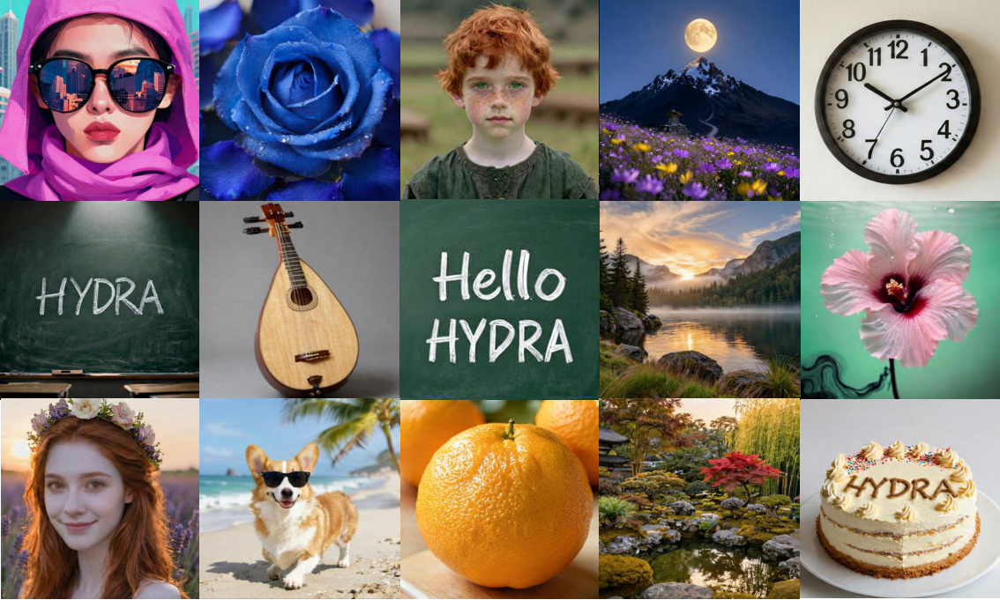
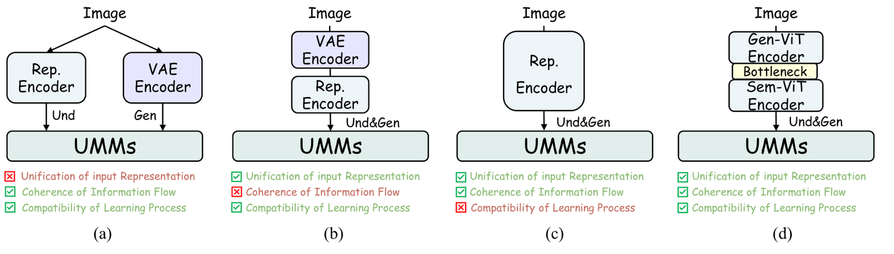
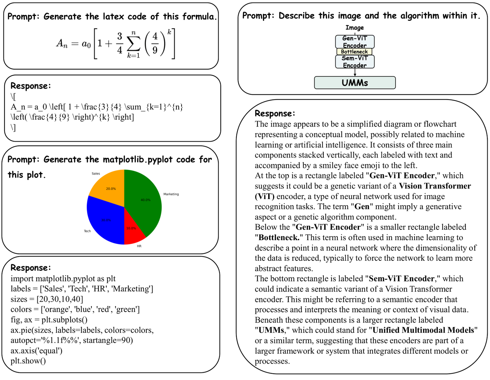
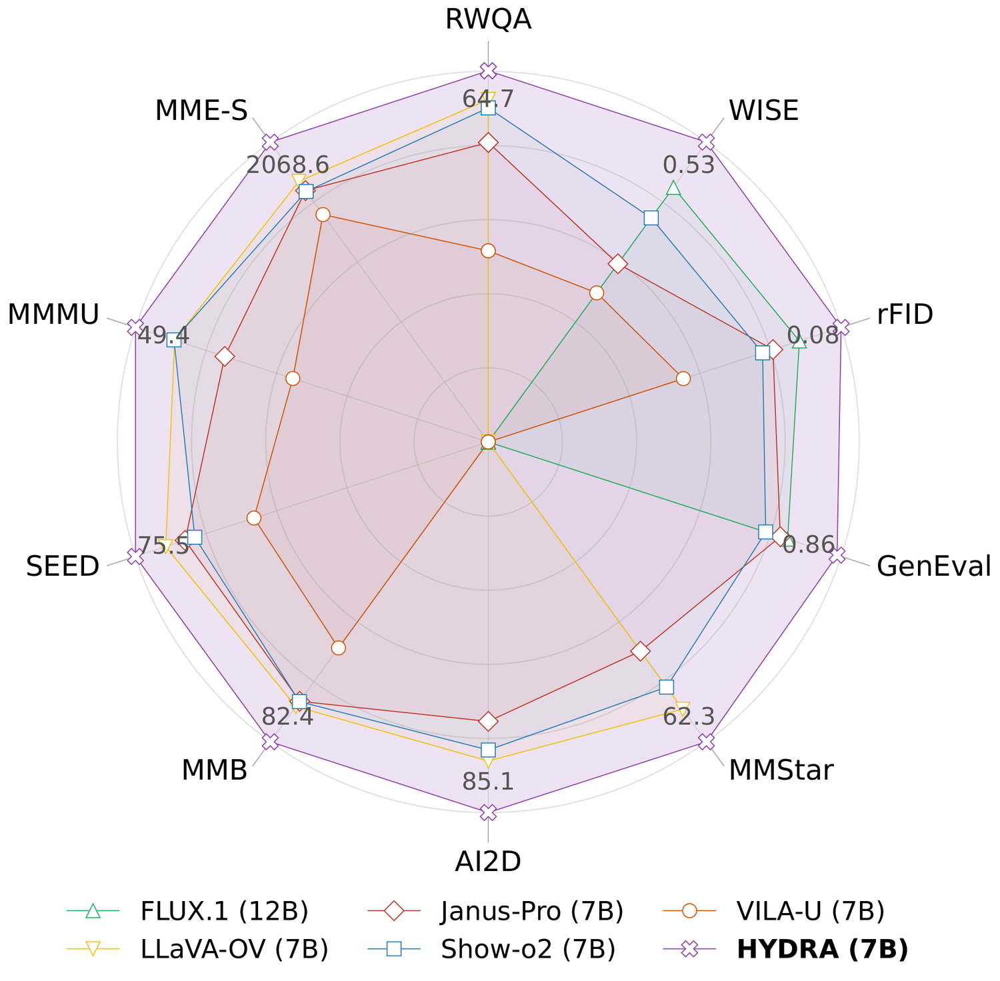
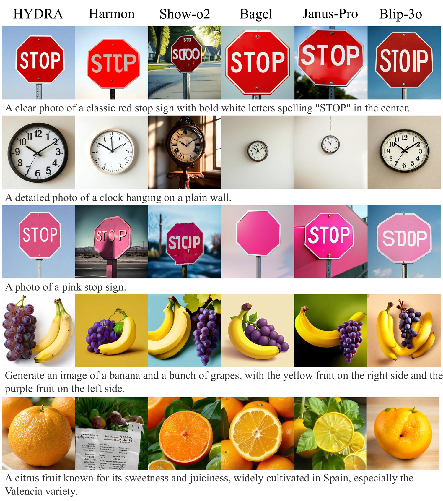
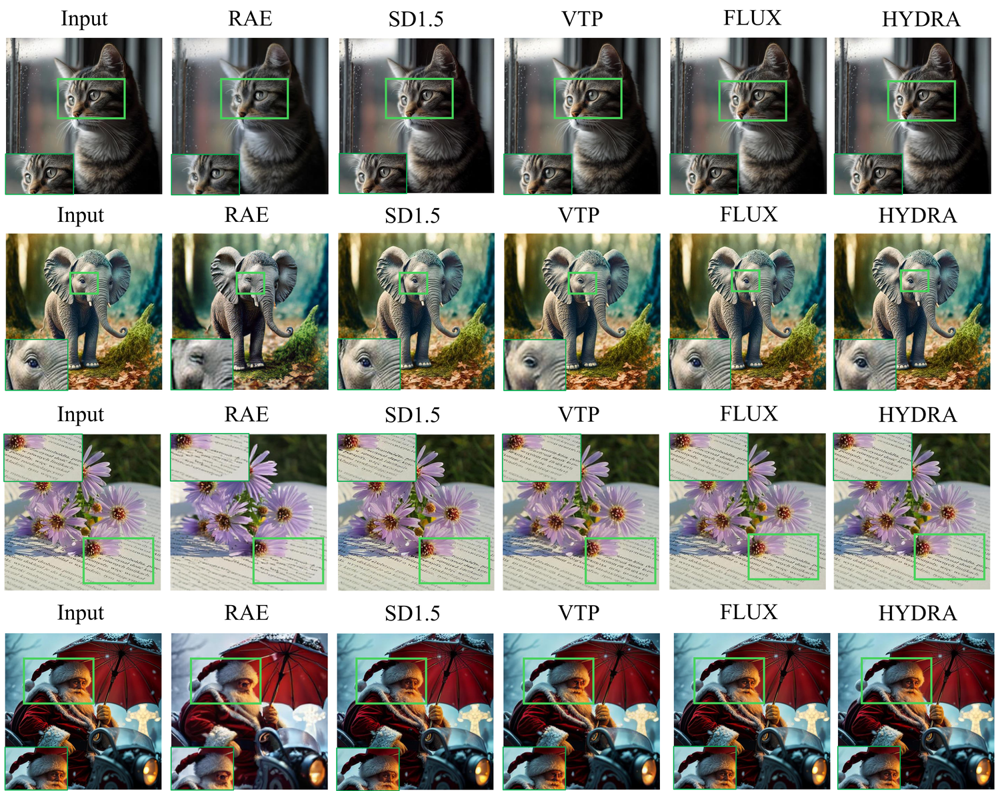

# HYDRA

### Representation Harmonized Tokenization for Multimodal Generation and Understanding

 [](https://arxiv.org/abs/2603.15228) [](LICENSE)

[](https://bollossom.github.io/HYDRA/) [](https://github.com/Tencent-Hunyuan/HYdra) [](https://huggingface.co/Xuerui123/HYdra) [](https://bollossom.github.io/HYDRA/training-logs/)

[Model Zoo](#-model-zoo) · [Quick Start](#-quick-start) · [Training](#-training) · [Results](#-results) · [Citation](#-citation)



---

## 📰 News

- **[2026-10]** 🎉 HYDRA is accepted by **NeurIPS 2026**!
- **[2026-10]** 🔥 Model weights released on [HuggingFace](https://huggingface.co/Xuerui123/HYdra) — HYDRA-1.5B, HYDRA-7B and both HYDRA-TOK tokenizers.
- **[2026-10]** 🔥 Inference, training and evaluation code released.

---

## 💡 Highlights

Unified multimodal models (UMMs) struggle to bridge the fundamental gap between
the abstract representations needed for visual **understanding** and the
detailed primitives required for **generation**. HYDRA closes this gap with a
single representation.

- 🧩 **HYDRA-TOK — one pure-ViT tokenizer, no quantization.** The backbone
  transitions from a **Gen-ViT** (structure-preserving primitives for synthesis)
  to a **Sem-ViT** (semantic encoding), mediated by a **Generation-Semantic
  Bottleneck (GSB)** that compresses features to 64 channels, filters noise for
  robust synthesis, then restores dimensionality for comprehension.
- 🔗 **HYDRA — a native unified framework.** A dual-head decoder (autoregressive
  for text, rectified flow matching for images) over a single shared parameter
  space.
- 🏆 **State-of-the-art on both halves of the problem** — strong reconstruction,
  generation and understanding from one model. See the
  [paper](https://arxiv.org/abs/2603.15228) for the full benchmark tables.



**Representation-harmonized ViT**: Gen-ViT + GSB + Sem-ViT + Pixel Flow Decoder.


**HYDRA unified framework**: dual-head (AR + flow matching) on a shared Qwen backbone.

---

## 🤗 Model Zoo

All weights live in a single HuggingFace repo:
**[Xuerui123/HYdra](https://huggingface.co/Xuerui123/HYdra)**

- **HYDRA-1.5B** and **HYDRA-7B** — the unified models (MMU + T2I), built on
  Qwen2.5-1.5B-Instruct and Qwen2.5-7B-Instruct.
- **HYDRA-TOK** — two tokenizer variants: the GAN-finetuned one
  (`hydra_tok_gan`, **use this for generation**) and the base stage-2 one
  (`hydra_tok_base`, for reconstruction and training init).
- **`hydra_tok_latent_stats.pt`** — the latent normalization statistics.

> [!TIP]
> **No download step is required.** `configs/inference.yaml` ships with
> `hf://Xuerui123/HYdra/...` paths, so every command in
> [Quick Start](#-quick-start) fetches exactly the weights it needs into the
> standard HuggingFace cache on first run and reuses them afterwards. Qwen2.5 is
> pulled the same way via `from_pretrained`.

To pre-stage everything instead (offline machines, shared cluster caches):

```bash
pip install -U huggingface_hub
huggingface-cli download Xuerui123/HYdra --local-dir ckpt
```

then override the path with `model_path=../ckpt/hydra_1.5b`.
`HYDRA_HF_SKIP_DOWNLOAD=1` disables `hf://` resolution entirely.

> [!NOTE]
> `hydra_tok_latent_stats.pt` is **not** optional — the flow-matching head
> consumes normalized latents, so every T2I entry point needs it alongside the
> tokenizer. See [ckpt/README.md](ckpt/README.md) for the full layout.

---

## 🚀 Quick Start

### Installation

```bash
# tokenizer (HYDRA-TOK)
cd hydra_tok && pip install -r requirements.txt

# unified model (HYDRA)
cd hydra && pip install -r requirements.txt
```

> [!IMPORTANT]
> `transformers` must be **4.x** (`>=4.45,<5`) — v5 removed
> `cache_utils.SlidingWindowCache`, which the Qwen2 backbone imports.

### Multimodal Understanding (MMU)

```bash
cd hydra
python evaluation/inference_mmu.py \
    config=configs/inference.yaml \
    mmu_image_path=./test.jpg \
    question='Describe this image.'
```

`mmu_image_path` also accepts a directory (every image inside is processed), and
several questions can be asked in one pass by separating them with ` *** `:

```bash
    question='What object is in this image? *** What is the surface made of?'
```



### Text-to-Image Generation (T2I)

`inference_t2i.py` is launched with `torchrun` — prompts are sharded across
ranks internally. Accepts `.txt`, `.csv` and WISE-style `.json` prompt files.

```bash
cd hydra
torchrun --nproc_per_node=8 evaluation/inference_t2i.py \
    config=configs/inference.yaml \
    t2i_prompts_file=prompts/t2i_prompts.txt \
    output_dir=samples
```

### Using the 7B

Override the three fields that differ from the 1.5B default:

```bash
python evaluation/inference_mmu.py config=configs/inference.yaml \
    model_path=hf://Xuerui123/HYdra/hydra_7b \
    model.llm.llm_model_path=Qwen/Qwen2.5-7B-Instruct \
    model.llm.hidden_size=3584 \
    mmu_image_path=./test.jpg question='Describe this image.'
```

For **T2I with the 7B**, also pass `transport.time_shifting_factor=3.0` — the 7B
was evaluated with a shift of 3.0, while the config default of 5.0 is the 1.5B
setting.

### Sampling protocol

Every sampling knob lives under `transport.`; a bare `guidance_scale=...` is
rejected rather than silently ignored. `configs/inference.yaml` ships the
HYDRA-1.5B GenEval/WISE setting.

| Setting | HYDRA-1.5B | HYDRA-7B |
| --- | --- | --- |
| `transport.guidance_scale` | 5.0 | 5.0 |
| `transport.time_shifting_factor` | 5.0 | **3.0** |
| `transport.num_inference_steps` — GenEval / WISE | 50 | **200** |
| `transport.num_inference_steps` — DPG-Bench | **100** | **100** |

Bold entries differ from the shipped defaults (`5.0 / 5.0 / 50`).
`time_shifting_factor` is the **only** timestep shift affecting generation — it
reshapes the sampling grid as `t → t / (t + f − f·t)`. The `do_shift` flag is
training-only and has no effect at inference.

---

## 🔧 Training

### HYDRA — three-stage progressive pipeline

| Stage | What happens | Data ratio (TU:IU:IG) | Steps | Frozen |
| --- | --- | --- | --- | --- |
| **I** | Image-text alignment, flow-head training | 0:1:3 | 150K | LLM |
| **II** | Joint training, all parameters | 0:2:2 | 100K | — |
| **III** | Quality refinement, instruction tuning | 1:2:2 | 20K | — |

```bash
cd hydra

# Stage I -> II -> III
bash scripts/train.sh configs/hydra_1.5b_stage1.yaml
bash scripts/train.sh configs/hydra_1.5b_stage2.yaml
bash scripts/train.sh configs/hydra_1.5b_stage3.yaml

# multi-node
bash scripts/train_multinode.sh configs/hydra_1.5b_stage1.yaml
```

> [!NOTE]
> Dataset paths in the shipped stage configs are `/path/to/...` placeholders.
> Fill in `dataset.params.*` with your own sources — the configs are templates
> for the recipe, not byte-exact reproductions of the released checkpoints.

### HYDRA-TOK — tokenizer

```bash
cd hydra_tok

# Stage 1: distillation from the InternViT teacher
bash scripts/train.sh stage1 --config configs/stage1.yaml

# Stage 2: large-scale refinement + GAN
bash scripts/train.sh stage2_gan --config configs/stage2_gan.yaml
```

### Evaluation

```bash
cd hydra_tok
bash tools/eval_all.sh <experiment_name> hydra_tok
```

Reconstruction metrics follow the paper protocol: 448 → 256 with PIL LANCZOS,
written as lossless PNGs, then rFID over the two directories.

---

## 📊 Results



HYDRA outperforms previous native UMMs and several task-specific models.



Generation comparison with other unified models.



Reconstruction quality on ImageNet.

---

## 📁 Repository Layout

```
HYdra/
├── hydra_tok/                  # HYDRA-TOK tokenizer
│   ├── train_stage1.py         #   Stage 1: InternViT distillation
│   ├── train_stage2_gan.py     #   Stage 2: + GAN refinement
│   ├── scripts/                #   launch scripts
│   ├── tools/                  #   evaluation (eval_top12 / eval_fid / eval_all.sh)
│   ├── configs/                #   stage1.yaml / stage2_gan.yaml / datasets_example
│   ├── hydra_tok/              #   model definition (Gen-ViT + GSB + Sem-ViT)
│   └── disc/                   #   discriminators (DINO / PatchGAN / DiffAug)
│
├── hydra/                      # HYDRA unified multimodal model
│   ├── train.py                #   entry point (stage routing)
│   ├── train_stage.py          #   unified trainer (Stages I/II/III)
│   ├── scripts/                #   train.sh / train_multinode.sh
│   ├── configs/                #   hydra_{1.5b,7b}_stage{1,2,3}.yaml + inference.yaml
│   ├── evaluation/             #   inference_mmu.py + inference_t2i.py
│   ├── models/                 #   HydraQwen2_5 + HYDRA-TOK vision towers
│   ├── datasets/               #   MMUDataset (LLaVA) + ImageTextDataset (T2I)
│   ├── transport/              #   flow matching (path, sampler, CFG tricks)
│   └── tools/                  #   utils, convert_showo_prefix, etc.
│
├── ckpt/                       # checkpoints (not in git; see ckpt/README.md)
└── assets/                     # figures from the paper
```

---

## 📦 Data Format

**T2I (generation)**

```
dataset_root/
├── data_info.json       # [{"image": "img_0.jpg", "annotation": "img_0.json"}, ...]
├── local_folder/        # images
│   └── img_0.jpg
└── cap_folder/          # captions
    └── img_0.json       # {"caption": "a red sports car..."}
```

**MMU (understanding) — LLaVA format**

```json
[{"id": "0",
  "image": "images/img_0.jpg",
  "conversations": [
    {"from": "human", "value": "<image>\nDescribe this image."},
    {"from": "gpt",   "value": "The image shows an ostrich..."}
  ]}]
```

See `hydra/datasets/example_mmu_datasets.yaml` for the multi-dataset config.

---

## 🙏 Acknowledgements

- [Show-o2](https://github.com/showlab/Show-o) — unified multimodal framework
- [InternViT / InternVL](https://github.com/OpenGVLab/InternVL) — ViT backbone & teacher
- [Qwen2.5](https://github.com/QwenLM/Qwen2.5) — LLM backbone
- [taming-transformers](https://github.com/CompVis/taming-transformers) — GAN / LPIPS losses
- [flash-attention](https://github.com/Dao-AILab/flash-attention)

---

## 📄 License

This project is released under the [MIT License](LICENSE).

---

## 📖 Citation

If you find HYDRA useful in your research, please consider citing:

```bibtex
@article{qiu2026hydra,
  title={{HYDRA}: Representation Harmonized Tokenization for Multimodal Generation and Understanding},
  author={Qiu, Xuerui and Cui, Yutao and Zhang, Guozhen and Li, Junzhe and Zhao, Yaqi and Zhang, Xiao and Li, Yang and Liu, Songtao and Yang, Miles and Shi, Yu and Zhong, Zhao and Bo, Liefeng},
  journal={arXiv preprint arXiv:2603.15228},
  year={2026}
}
```
