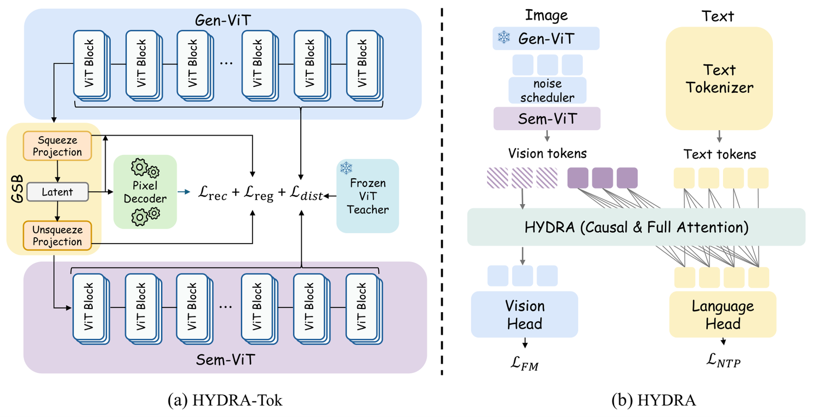

# HYDRA: Native Unified Multimodal Model

HYDRA integrates visual understanding and generation in a **single
parameter space**, with HYDRA-TOK latents as the only visual interface.

<div align="center">

<br>
<sub>Dual-head decoder — autoregressive for text, rectified flow
matching for images — on a shared Qwen2.5 backbone.</sub>
</div>

**Data flow**: images enter as 64-channel HYDRA-TOK latents, text as
ordinary embeddings; both are consumed by one `HydraQwen2_5` backbone
(Qwen2.5 1.5B or 7B) that feeds two heads.

| Path | How it works |
|---|---|
| **Generation** | The flow head regresses the velocity of *normalized* HYDRA-TOK latents (AdaLN-modulated, `num_diffusion_layers: 10`). The Pixel Flow Decoder is not needed at the LLM stage — it only turns the final latent into pixels. |
| **Understanding** | `Und_ViT` (the Sem-ViT half) maps latents to semantic features, projected into the LLM space by `semantic_proj`, then decoded by the AR LM head under an NTP loss. |

## Setup

```bash
pip install -r requirements.txt
```

## Training — one entry point

```bash
bash scripts/train.sh <config.yaml> [key=value overrides...]
```

All three stages go through the single `train.py` entry point; the stage is
inferred from the config file name (or set explicitly with `stage=N`).

| Stage | Config (1.5B / 7B) | What happens | Trainable |
|---|---|---|---|
| I | `configs/hydra_{1.5b,7b}_stage1.yaml` | Image-text alignment, flow head warmup | LLM frozen |
| II | `configs/hydra_{1.5b,7b}_stage2.yaml` | Joint training | All params |
| III | `configs/hydra_{1.5b,7b}_stage3.yaml` | Quality refinement, instruction tuning | All params |

```bash
bash scripts/train.sh configs/hydra_1.5b_stage1.yaml       # 1.5B, stage I
bash scripts/train.sh configs/hydra_7b_stage3.yaml         # 7B, stage III
bash scripts/train.sh configs/hydra_1.5b_stage2.yaml training.lr=1e-5
```

Launch defaults come from `configs/zero2.yaml` (DeepSpeed ZeRO-2 via
accelerate); override with `NUM_GPUS=` / `ACCELERATE_CONFIG=`.

Multi-node: `bash scripts/train_multinode.sh <config.yaml>` (see script header
for `hosts.txt` / SSH prerequisites).

### Config prerequisites

The shipped configs use `/path/to/...` placeholders. Point these at your
local assets before launching (see `configs/hydra_1.5b_stage1.yaml`):

| Field | What it needs |
|---|---|
| `model.hydra_tok_model.pretrained_model_path` | A HYDRA-TOK checkpoint directory containing `gen_vit_weights.pth` and `und_vit_weights.pth` |
| `model.hydra_tok_model.latent_stats_path` | Latent statistics, produced by `../hydra_tok/tools/calculate_latent_top12.py` |
| `model.llm.llm_model_path` | A Qwen2.5-Instruct checkpoint (1.5B or 7B, matching `model.llm.hidden_size`: 1536 / 3584) |
| `dataset.params.train_t2i_*`, `train_mmu_*` | Your dataset shards and roots |

## Inference

```bash
# understanding
python evaluation/inference_mmu.py config=configs/inference.yaml \
    mmu_image_path=./test.jpg question='Describe this image.'

# generation (prompt-set inference, GenEval / DPG-Bench / WISE)
torchrun --nproc_per_node=8 evaluation/inference_t2i.py config=configs/inference.yaml t2i_prompts_file=prompts/t2i_prompts.txt
# WISE benchmark: json prompt directory
# torchrun --nproc_per_node=8 evaluation/inference_t2i.py \
#     config=configs/inference.yaml t2i_prompts_file=/path/to/wise_prompts
```

## Data format

```
dataset_root/
├── data_info.json     # [{"image": "img_0.jpg", "annotation": "img_0.json"}, ...]
├── local_folder/      # images
└── cap_folder/        # {"caption": "..."} JSONs
```

Multi-dataset MMU: see `datasets/example_mmu_datasets.yaml`.

## Sampling knobs

Set under `transport:` in the inference config, or overridden on the CLI:

| Field | Default | Effect |
|---|---|---|
| `guidance_scale` | 5.0 | CFG strength. Higher tightens prompt adherence at the cost of diversity; 5.0 was used for every reported benchmark. |
| `num_inference_steps` | 50 | Euler steps for the latent flow. 50 for 1.5B GenEval/WISE, 100 for DPG-Bench, 200 for the 7B on GenEval/WISE. |
| `time_shifting_factor` | 5.0 | Timestep-grid shift, the only shift affecting sampling. 5.0 for the 1.5B, **3.0 for the 7B**. |
| `cfg_start` / `cfg_end` | 0.0 / 1.0 | Normalized timestep window in which CFG is applied — `0.0`/`1.0` means the whole trajectory. |
| `rescale_factor` | 1.0 | Post-CFG rescaling, to counter over-saturation at high `guidance_scale`. |
